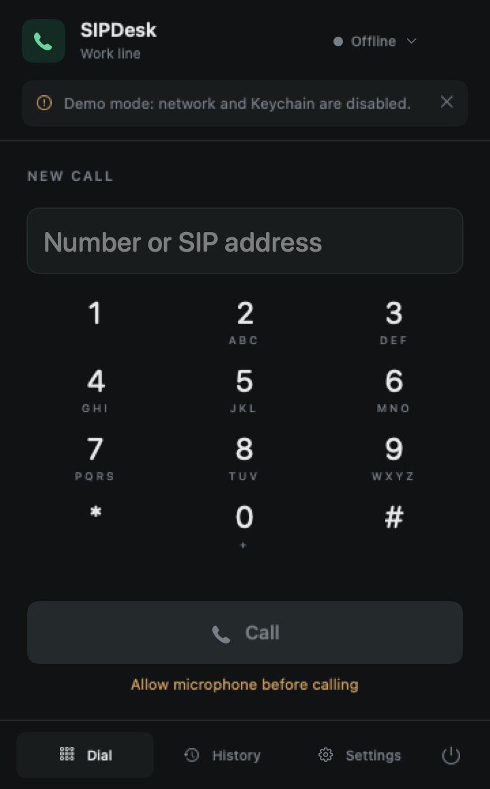
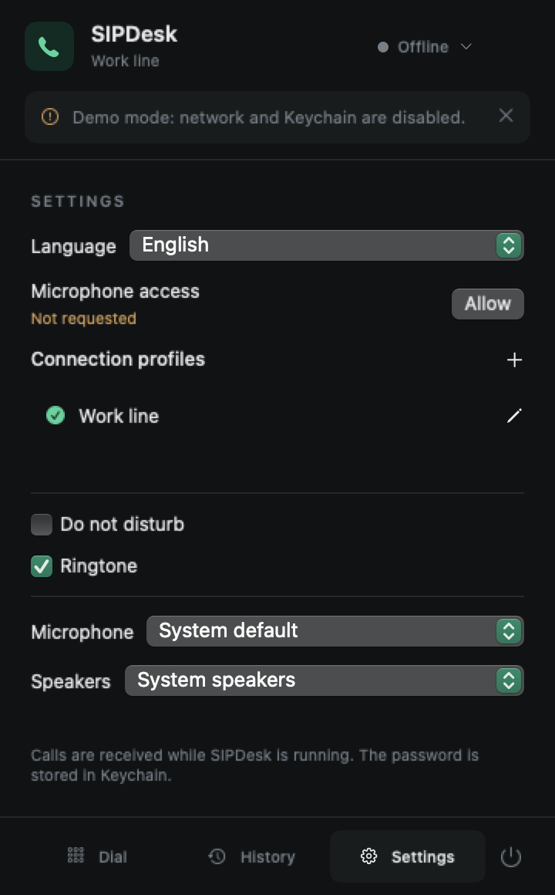

# SipDesk

**A native macOS menu-bar SIP softphone.** SwiftUI and AppKit for the interface;
PJSIP for calls. Connect directly to your own PBX or SIP provider—no browser or
Electron runtime, and no SipDesk service account.

> Early-stage, source-build project for **Apple Silicon · macOS 14+**.
> [Download](https://github.com/Jeishod/sipdesk/releases/latest) · Ad-hoc signed, not notarized.

<p align="center">
  
  
</p>

*Real app renders with synthetic preview data; network and Keychain disabled.
English interface shown. [Screenshot provenance](docs/images/README.md).*

## Features

- Ten languages: English, Russian, Kazakh, Portuguese, Spanish, French, German,
  Chinese, Hindi and Arabic. Settings → Language supports a saved override or
  automatic macOS language selection with English fallback. Arabic supports RTL.
- Compact menu-bar interface: dialer, local history and settings; no Dock window on launch.
- Multiple saved SIP profiles with **one active line and one call at a time**.
- Incoming/outgoing voice calls, mute, hold/resume, DTMF via RTP (RFC 4733) or SIP INFO.
- SIP over **UDP, TCP or TLS**; **SRTP/SDES** with TLS when supported by the server.
- G.711 μ-law/A-law and G.722; software echo cancellation; input/output device selection.
- Do Not Disturb, registration recovery after sleep, and up to 200 local history entries.
- SIP passwords in macOS Keychain. Microphone permission is requested explicitly
  in Settings **before** a call, not during dialing or answering.
- `sip:`, `sips:` and `tel:` links fill the dialer; they do not start calls automatically.

## Build and run

For the packaged app, download the DMG from [Releases](https://github.com/Jeishod/sipdesk/releases),
drag SipDesk into Applications, and allow microphone access in Settings before
calling. macOS may require Privacy & Security → Open Anyway where permitted.

Requires an Apple Silicon Mac, macOS 14+, Xcode or Command Line Tools with
**Swift 6+**, `make`, `curl` and Python 3. No Homebrew packages are required.

```sh
git clone https://github.com/Jeishod/SipDesk.git
cd SipDesk
./build.sh --run
```

The first build downloads a pinned, SHA-256-checked PJSIP snapshot and builds it
locally. Dependencies stay in `.dependencies/`; the app is `build/SIPDesk.app`.
`--run` opens it; omit that flag to build only. The script does not install into
`/Applications` or connect to a SIP server. Run the packaged `.app`, not `swift run`,
for microphone access and bundled resources.

Builds are ad-hoc signed by default. An existing signing identity can be supplied
with `SIGNING_IDENTITY="Your existing signing identity" ./build.sh`; the script
creates no certificates and performs no notarization. Rebuilds may trigger fresh
macOS microphone or Keychain permission checks.

### Connect your line

1. Open the phone icon in the menu bar → **Settings (Настройки)**. Grant microphone
   access with **Allow (Разрешить)** before placing or answering a call. If denied,
   enable SipDesk in macOS Privacy & Security → Microphone.
2. Add a profile: server hostname (for example `pbx.example.com`), separate port,
   SIP username and password. Enter credentials only in the app, never in issues.
3. Match the provider's transport; configure auth ID, proxy, STUN/ICE, SRTP or DTMF
   only as required by your PBX. Save and connect; wait for **Online (На связи)**.
4. Dial an extension, number or SIP URI. Check both audio directions on a test call.

Closing the panel leaves the app running. Incoming calls require a running app,
an awake Mac and network access. Use the status menu to go offline or quit the app.

## Tests and development

```sh
./Scripts/test.sh
```

This runs Swift core/runtime tests and Python loopback integration tests using
`SIPProbe`: Digest registration over UDP/TCP, rejected credentials, unregister,
call signaling, synthetic RTP, DTMF, hold/resume, mute, busy, cancel/decline, IPv6
and rejection of an untrusted TLS certificate. It needs no real account, PBX or
microphone; dependency bootstrap needs network access on the first run.

[CI](.github/workflows/ci.yml) runs the same headless tests on an Apple Silicon
macOS runner. It does **not** run GUI tests, request permissions, upload binaries
or publish releases. GUI checks require a local graphical macOS session.
See [development notes](docs/development.md) for architecture and local UI checks,
and [CONTRIBUTING.md](CONTRIBUTING.md) for contribution guidance.

## Security and privacy

- Passwords are stored in Keychain, keyed by profile UUID, not in settings JSON.
  Settings and history live in `~/Library/Application Support/SIPDesk/` with private
  file permissions; **JSON is not encrypted** and history contains caller identifiers.
- No call recording or telemetry. Microphone capture is not started for registration
  or idle incoming-call monitoring.
- TLS validates server certificates using Apple's networking stack; there is no
  “ignore certificate” option. Private CA trust must be configured outside SipDesk.
- **UDP/TCP and plain RTP are unencrypted. TLS alone does not encrypt voice.**
  Prefer TLS + required SRTP where supported; SDES keys require encrypted signaling.
- No public STUN server is configured by default. Caller ID is not proof of identity.

Read [SECURITY.md](SECURITY.md) before sharing diagnostics or reporting a vulnerability.

## Known limitations

- Physical microphone/headset operation, audible quality and echo cancellation are
  **not confirmed by loopback tests**. Provider, NAT and TLS/SRTP interoperability
  need a real test call; this is not an emergency-calling solution.
- Saved profiles are not simultaneous lines. No transfer, conferencing, video,
  recording, address book, BLF/presence, Opus, G.729 or TURN.
- No auto-updater, login-item integration, App Store distribution or notarization.
  Intel and universal builds are not a supported/verified distribution target.
- The PJSIP dependency is a pinned **2.17-dev snapshot**, not a stable-release claim.
  Exact revision, checksum and upstream notices: [THIRD_PARTY_NOTICES.md](THIRD_PARTY_NOTICES.md).

## License

SipDesk is licensed under **GPL-2.0-or-later**. See [LICENSE](LICENSE) for the full
terms and [NOTICE](NOTICE) for the copyright and version-or-later grant.

PJSIP is dual-licensed under **GPL v2 or later**, or a separate commercial license
from Teluu. Distributing a statically linked app requires choosing and complying
with an appropriate licensing path: the GPL route generally requires a compatible
application license and corresponding source; a commercial PJSIP license must be
obtained separately. Bundled third-party obligations still apply. No commercial
license is included. Review [upstream licensing](https://www.pjsip.org/licensing.htm)
and [third-party notices](THIRD_PARTY_NOTICES.md) before distribution.
